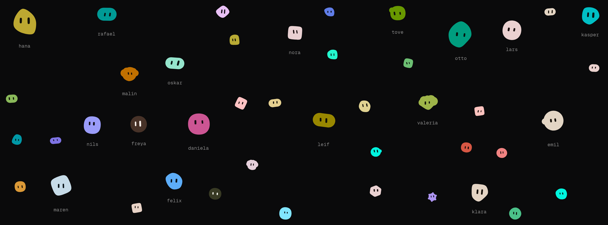
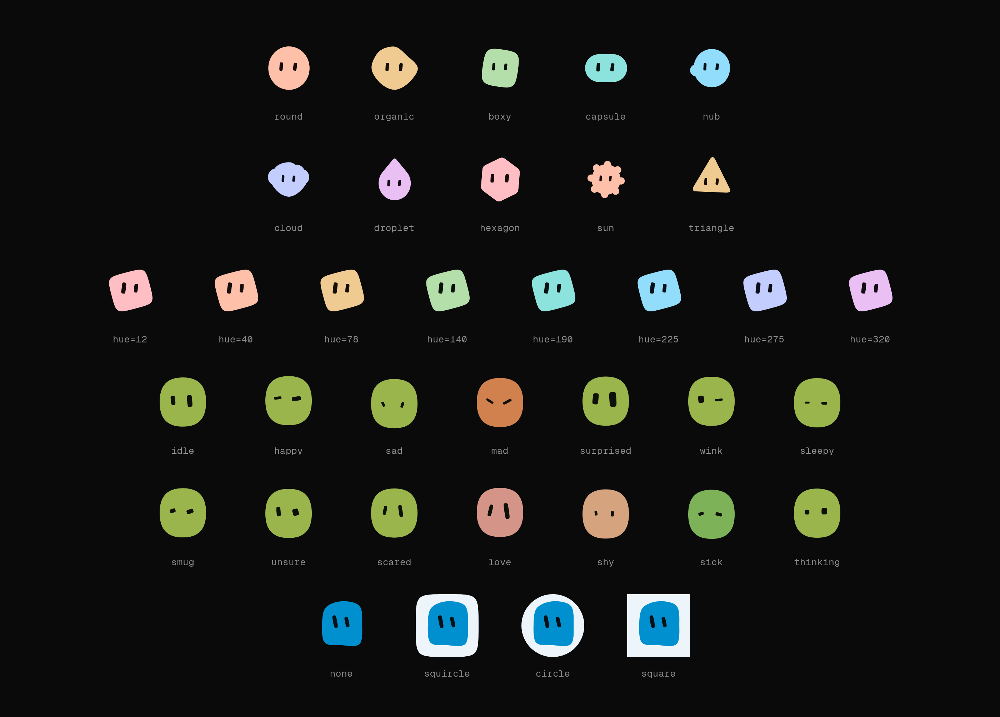

# Blobatar.Net

Independent C# port of [Alain00/blobatar](https://github.com/Alain00/blobatar), based on
[v2.7.0](https://github.com/Alain00/blobatar/tree/v2.7.0), maintained by
[MilaDesign](https://github.com/MilaDesign). Generate deterministic geometric avatars from
strings, with expressions, idle animation and pointer gaze.



Preview image from the [original Blobatar project](https://github.com/Alain00/blobatar).

**Publication status:** source is available at [MilaDesign/Blobatar.Net](https://github.com/MilaDesign/Blobatar.Net).
All seven libraries are available on NuGet.org as **2.7.0**. This is an independent port,
not an official upstream SDK.

## Vibe coding with AI

This .NET port was **vibe coded using GPT, Claude and Gemini**, with MilaDesign directing
development and maintaining the project. This disclosure applies to the .NET port;
the original Blobatar project is credited separately below.

## Packages

| Package | Purpose | Library targets | NuGet |
| --- | --- | --- | --- |
| [Blobatar.Net.Core](src/Blobatar.Net.Core/README.md) | Generation, SVG and shared animation/gaze logic; no UI dependencies | .NET 6–10 | [2.7.0](https://www.nuget.org/packages/Blobatar.Net.Core/2.7.0) |
| [Blobatar.Net.Wpf](src/Blobatar.Net.Wpf/README.md) | WPF rendering | .NET 6–10, Windows | [2.7.0](https://www.nuget.org/packages/Blobatar.Net.Wpf/2.7.0) |
| [Blobatar.Net.WinForms](src/Blobatar.Net.WinForms/README.md) | Windows Forms / GDI+ rendering | .NET 6–10, Windows | [2.7.0](https://www.nuget.org/packages/Blobatar.Net.WinForms/2.7.0) |
| [Blobatar.Net.Avalonia](src/Blobatar.Net.Avalonia/README.md) | Avalonia 11 rendering | .NET 6–10 | [2.7.0](https://www.nuget.org/packages/Blobatar.Net.Avalonia/2.7.0) |
| [Blobatar.Net.UnoPlatform](src/Blobatar.Net.UnoPlatform/README.md) | WinUI shapes with Uno Platform | .NET 6–10; extra Windows target on .NET 8 | [2.7.0](https://www.nuget.org/packages/Blobatar.Net.UnoPlatform/2.7.0) |
| [Blobatar.Net.Maui](src/Blobatar.Net.Maui/README.md) | MAUI vector rendering and native Windows pointer tracking | .NET 8–10; portable and Windows assemblies | [2.7.0](https://www.nuget.org/packages/Blobatar.Net.Maui/2.7.0) |
| [Blobatar.Net.Godot](src/Blobatar.Net.Godot/README.md) | Godot .NET rendering and Inspector integration | .NET 6–10, matching Godot bindings | [2.7.0](https://www.nuget.org/packages/Blobatar.Net.Godot/2.7.0) |

Install the adapter you need; Core is included as a dependency:

```shell
dotnet add package Blobatar.Net.Wpf
```

For local development, reference the adapter project directly.
The namespace identifiers below work without published web pages at those URLs.

The [release workflow](.github/workflows/release.yml) builds and tests all seven libraries,
publishes their packages to NuGet.org, and creates one GitHub release containing the packages,
changelog entry and NuGet links.

## Core

```csharp
using Blobatar.Net.Core;

string svg = BlobatarSvg.Render("MilaDesign", new BlobatarOptions
{
    Background = BackdropStyle.Circle,
    Hue = 200,
    Expression = Expressions.Happy,
});
```

The same normalized string and options produce the same avatar. Rendering happens locally,
without an avatar service. See the [Core README](src/Blobatar.Net.Core/README.md) for options.

## XAML

WPF and Avalonia register the control in their default framework namespaces:

```xml
<BlobatarControl Seed="MilaDesign" Width="96" Height="96"
                 Animate="True" Expression="Happy" Gaze="Pointer" />
```

They also expose project-specific namespace URLs. The assembly metadata suggests `bl` via
`XmlnsPrefix`; declare the prefix on your root element when using the custom URL:

| Framework | Declaration |
| --- | --- |
| WPF | `xmlns:bl="https://github.com/MilaDesign/Blobatar.Net/wpf"` |
| Avalonia | `xmlns:bl="https://github.com/MilaDesign/Blobatar.Net/avalonia"` |
| MAUI | `xmlns:bl="https://github.com/MilaDesign/Blobatar.Net/maui"` |
| Uno Platform | `xmlns:bl="using:Blobatar.Net.UnoPlatform"` |

```xml
<!-- WPF / Avalonia / Uno with the matching declaration above -->
<bl:BlobatarControl Seed="MilaDesign" Width="96" Height="96"
                    Animate="True" Gaze="Pointer" />

<!-- MAUI uses WidthRequest / HeightRequest -->
<bl:BlobatarControl Seed="MilaDesign" WidthRequest="96" HeightRequest="96"
                    Animate="True" Gaze="Pointer" />
```

MAUI uses its custom namespace. Uno retains WinUI's `using:` syntax across the targeted versions.
`XmlnsPrefix` supplies a suggested prefix; it does not replace a namespace declaration.

## Windows Forms and Godot

```csharp
var avatar = new Blobatar.Net.WinForms.BlobatarControl
{
    Seed = "MilaDesign", Width = 96, Height = 96,
    Animate = true, Gaze = Blobatar.Net.Core.GazeMode.Pointer,
};
Controls.Add(avatar);
```

```csharp
var avatar = new Blobatar.Net.Godot.BlobatarControl
{
    Seed = "MilaDesign", CustomMinimumSize = new Godot.Vector2(96, 96),
    Animate = true, Gaze = Blobatar.Net.Core.GazeMode.Pointer,
};
AddChild(avatar);
```

Godot requires the .NET edition. Its package installs a script resource during the game build;
the sample includes a project-local wrapper for Add Node and Inspector integration.

## Configuring

Set `Hue` to choose a color in degrees (0–360), `Tone` to choose its shade (0–1),
`Backdrop` to select a background, and `Expression` to choose a facial expression:

```xml
<bl:BlobatarControl Seed="MilaDesign" Width="96" Height="96"
                    Backdrop="Circle" Hue="210" Tone="0.5" Expression="Happy" />
```

In Core, the background option is named `Background`. Use `BlobatarOptions.Traits` to
pin individual geometry traits to positions from 0 to 1; unspecified traits still come
from the seed:

```csharp
string svg = BlobatarSvg.Render("MilaDesign", new BlobatarOptions
{
    Background = BackdropStyle.Squircle,
    Hue = 210,
    Traits = new Dictionary<string, double[]>
    {
        ["shape"] = new[] { 0.95 },
        ["eye.ratio"] = new[] { 0.0 },
    },
});
```

See the [Core README](src/Blobatar.Net.Core/README.md) for more options. The configuration
sheet below shows the available silhouettes, hues, expressions and backgrounds.



Configuration image from the [original Blobatar project](https://github.com/Alain00/blobatar).

## Animation and gaze

Controls are static by default. Set `Animate = true` for idle animation, expression morphing and
animated gaze. `Gaze = Pointer` follows the cursor across the containing window/page where the
adapter supports it; `Rest` keeps the eyes facing forward, and `None` disables pointer aiming.
`GazeTarget` overrides pointer gaze with an element in the same window/viewport. `GazeTravel`
controls the travel distance (default 3). Framework-specific lifecycle, accessibility and
platform behavior are described in the adapter READMEs. Hover lift and the upstream slow-motion
debug dial are not included.

## Build, samples and tests

Use the .NET 10 SDK on Windows for the complete solution. Install the MAUI workload for its
sample, and provide the Godot SDK/bindings required by `GodotVersions.props` through NuGet.
Older samples/tests require their matching .NET runtime. Core, Avalonia and Godot projects
can be built separately on their supported platforms.

```powershell
dotnet restore Blobatar.Net.sln
dotnet build Blobatar.Net.sln -c Release --no-restore
dotnet test tests/Blobatar.Net.Tests -c Release --no-restore
dotnet test tests/Blobatar.Net.Maui.Tests -c Release --no-restore
```

| Sample | Run / build instructions |
| --- | --- |
| [WPF](samples/Blobatar.Net.Wpf.Sample/README.md) | .NET 6/7/8, Windows |
| [Windows Forms](samples/Blobatar.Net.WinForms.Sample/README.md) | .NET 6/7/8, Windows |
| [Avalonia](samples/Blobatar.Net.Avalonia.Sample/README.md) | .NET 6/7/8 |
| [Uno Platform](samples/Blobatar.Net.UnoPlatform.Sample/README.md) | .NET 6–10; GTK on 6/7, Skia Desktop on 8–10 |
| [MAUI](samples/Blobatar.Net.Maui.Sample/README.md) | .NET 10 by default; 8/9 require matching workloads |
| [Godot](samples/Blobatar.Net.Godot.Sample/README.md) | .NET 8–10 with Godot 4.7 .NET |

Core tests include 254 SVG reference cases and further expressions, motion, gaze, paths and
scene checks against upstream-derived data. MAUI has rendering and pointer lifecycle tests.
Godot's in-engine smoke test covers native rendering and actual mouse exits/re-entries.
See [CONTRIBUTING.md](CONTRIBUTING.md) and [CHANGELOG.md](CHANGELOG.md) for development information.

## License and attribution

[MIT](LICENSE). Original Blobatar copyright (c) 2026 Alain; .NET port and adapters copyright
(c) 2026 MilaDesign. The upstream algorithms and reference data retain Alain's notice.
Every library package includes the license and [third-party notices](THIRD-PARTY-NOTICES.md).
The MAUI sample's bundled Open Sans fonts have a separate Apache 2.0 license, included beside
the font files. Framework dependencies retain their own licenses.
